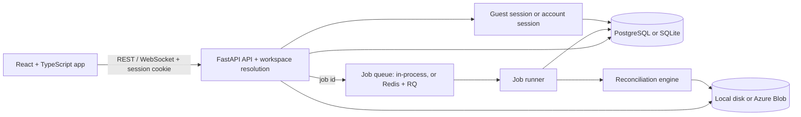
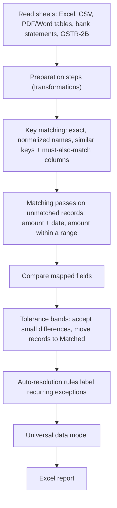

# Architecture

RecliQ has four core runtime parts: a React single-page app, a FastAPI backend, a job runner, and the reconciliation engine. It supports two workspace identities: anonymous guest sessions and optional registered accounts. The backend stores records in SQL and files in the configured storage backend; all API and worker reads are scoped to the active workspace.

## Components

| Component | Where | Responsibility |
|---|---|---|
| Frontend | `frontend/src` | The six-step setup wizard, results dashboard, history, saved setups, aliases, auto-resolution, learning and audit pages. `src/lib` holds plan building and validation, free of React and unit-tested |
| API | `backend/app/api/routes` | Guest sessions, authentication, workspaces, uploads, analysis and pre-check, runs, reports, administration, saved setups, aliases, rules, learning, audit |
| Services | `backend/app/services` | Orchestration: accounts, policies, quotas, runs, templates, pre-check, aliases, auto-resolution, learning, audit, email and retention |
| Job runner | `backend/app/jobs` | Queue, worker, and recovery of runs whose worker stopped |
| Engine | `backend/app/reconciliation_engine` | Reading files, preparing values, matching, tolerances, auto-resolution and the Excel report |
| Entry points | `backend/app/reconciliation` | The generic and GST entry points and the original value matchers (`matchers.py`) |
| Storage | `backend/app/storage` | Local and Azure Blob implementations behind one interface |

## A run from start to finish

1. **Upload.** The browser uploads each file to `POST /api/files/upload`. The backend resolves the active workspace, checks the extension against workspace policy, verifies content and size/row limits, stores the file under that workspace, records its SHA-256 in the audit log, and starts reading it in the background.
2. **Set up.** The wizard reads sheets and headers (`/files/{id}/metadata`, `/files/{id}/columns`) and asks `POST /analysis/` for key and column suggestions. The user builds a **plan**: file pairs, each with one or more sheet rules (keys, conditions, passes, mappings, preparation steps, tolerances, date format).
3. **Check.** `POST /analysis/precheck` reads the sheets exactly as the run will and reports blockers and warnings. Warnings must be confirmed, and the confirmation is stored with the run.
4. **Queue.** `POST /reconciliation/generic` validates the plan, stores it with the job (`settings_json`) and queues the job.
5. **Run.** A worker claims the job, rechecks account status and the relevant feature policy, then runs every sheet rule (see the next section), keeping a heartbeat. Progress is visible through `GET /jobs/{id}` and the `/jobs/{id}/ws` WebSocket.
6. **Report.** Results from all rules are merged into one data model and written as an Excel workbook (one per file pair when there are several), and the report data is stored separately for previews and custom reports.
7. **Review.** The results page shows counts and previews. Reviewers confirm or reject proposed matches, which feeds learning and alias suggestions. **Run Again** reopens the workspace-scoped generic plan (`GET /jobs/{id}/plan`) or GST setup (`GET /jobs/{id}/gst-plan`) in the wizard and starts a new run on the same retained files.

## Inside the engine (per sheet rule)

- **Reading** (`ingestion/`): workbooks are parsed once and cached. PDF tables are read cell by cell, joined across pages, and header rows are detected. Bank statement formats are turned into Transactions and Balances sheets.
- **Preparation** (`transformations.py`): a fixed list of steps (trim, remove prefixes, invert signs, debit/credit to a signed amount, round half up, and more) applied to working copies. The report keeps the original values.
- **Key matching** (`matching/`, `normalization/`): keys are compared after removing spacing, case and punctuation, with company-name normalization (legal forms, abbreviations, word order) and approved aliases. Near matches become "matches to confirm". Reviewers' rejected pairings are not proposed again.
- **Passes** (`matching/pass_matcher.py`): pair records the key did not find, only when the pairing is unique on both sides.
- **Tolerances** (`tolerance.py`): after matching, differences within a band (an amount, a percentage of the destination value, a number of days, or a text similarity) are accepted. The report says why in the comment.
- **Auto-resolution** (`resolution.py`): the session's rules, in order, label exceptions such as bank charges; the report lists them on the Auto-resolved sheet.
- **Report** (`universal_mapper.py`, `universal_reporter.py`): builds the Summary, Differences, Only in File 1, Only in File 2, Match Review, Matched, Checks, Sheet Rules and Auto-resolved sheets.

## Identity, authorization and policy

- Guest sessions use a UUID and remain anonymous; the session cookie and `X-Session-ID` keep guest data isolated. Registered accounts use a random opaque session token in an HttpOnly cookie; only its hash is stored in `user_sessions`.
- For account requests, workspace ownership resolves to `user-<user UUID>`. An `X-Session-ID` header cannot switch an authenticated request back to a guest or another account. Unsafe cookie-authenticated requests require the CSRF token returned by the identity API.
- `get_session_id()` is the workspace boundary used by file, job, report, saved-setup, alias, rule and audit queries. Workers use the persisted workspace ID and re-check account status and reconciliation policy before executing.
- Public registration can create only regular users. Super Admins are provisioned from deployment secrets and must have MFA enabled. Administrative routes additionally verify role, active status and MFA server-side.
- Global feature defaults can be further restricted per account. Usage limits are selected from guest or registered defaults; account-level numeric quotas can be changed within deployment hard caps, and account upload formats are intersected with the global allowed formats. Critical ownership, authentication, CSRF, admin, and audit controls are not policy-switchable.
- Guest import is explicit, ownership-checked and recorded; it is not run automatically on account creation or sign-in.

## Data

- **Database**: files, jobs and their history, reports, saved setups and their versions, aliases and decisions, auto-resolution rules and the audit log. Migrations are managed with Alembic (`backend/alembic`). The audit log is append-only: the ORM and database triggers refuse updates and deletes.
- **Storage**: uploads, parsed-sheet caches, reports and report data are stored under a workspace-specific scope. Guests retain session-scoped paths; accounts use a stable `user-<UUID>` scope.
- **Retention**: guests keep their latest 20 runs, and all guest data is deleted one day after it was created (`GUEST_RETENTION_HOURS`; see [operations-and-security.md](operations-and-security.md#guest-data-is-kept-for-one-day)). Registered workspaces use the configured report-retention period; zero means no time-based pruning. Files are removed only when no retained run needs them.
- **Migration**: Alembic revisions `20261009_0001` and `20261010_0001` add account/policy/email records and widen storage counters without rewriting guest ownership. Review the backup and upgrade guidance before a production migration.

## Design choices

- **The plan is the contract.** The wizard, saved setups, re-runs and the API all produce the same plan format, and the engine only reads plans.
- **Nothing is accepted silently.** Near matches need confirmation, aliases need approval, learning never confirms matches by itself, and tolerances write their reason into the report.
- **Jobs survive restarts.** The database row is the source of truth; a sweeper re-queues runs whose worker stopped, up to a retry limit.
- **Policies are enforced twice where needed.** APIs validate permissions before accepting work; workers recheck account status and reconciliation feature flags before processing queued jobs.

More detail: [TECHNICAL_ARCHITECTURE_GUIDE.md](TECHNICAL_ARCHITECTURE_GUIDE.md) and [operations-and-security.md](operations-and-security.md).
