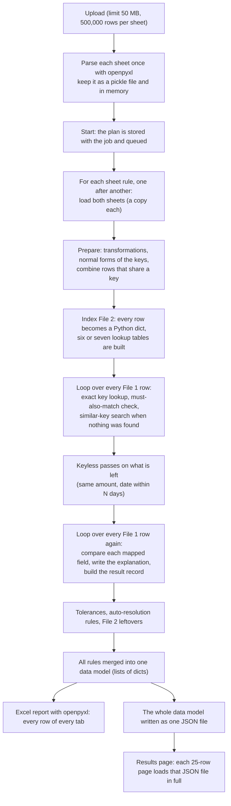
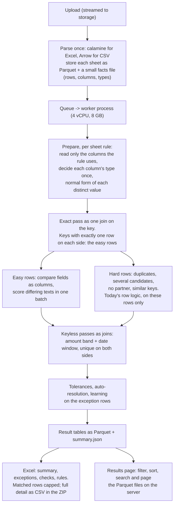

# Scaling RecliQ to 1,000,000 rows per file

**Status (12 October 2026): Phases 1, 1b and 1c are complete; Phase 2 implementation is complete and its evidence is recorded below.** The owner-controlled 100,000-row Phase 1b run measured 40.27 seconds end to end and 18.80 seconds for reading and matching, below the Phase 1 result of 57.80 seconds and 25.82 seconds. Phase 1c split generic reconciliation into typed preparation, key matching, keyless matching and result-building stages; all four output comparisons are identical. Phase 2 now stores parsed sheets and result categories as Parquet, serves bounded result queries, streams report generation and runs data-quality checks in a worker process. The full 500,000-row results-page round trip and benchmark workbook cell-by-cell parity still need verification before Phase 2 is called fully closed. Phase 0 live-container sizing remains owner-controlled; Phases 3-4 are not started. Measurements can be repeated with the scripts in [`scripts/perf`](../scripts/perf/README.md).

- Code measured: `main` at commit `2a3a10c` (1 October 2026); measurements taken 1 to 3 October 2026. `main` has since moved to `4197f58` (3 October), which changed the tolerance editor, number display and workbook pairing but not the engine's matching code. The last round of checks (reader comparison, results-page cost, text-score batch, one prototype per process, and the test suite with the three engine changes) ran on `4197f58`. Line references are to `4197f58`. Re-run the baseline table on the current code before closing Phase 0.
- Machine: laptop, AMD Ryzen 5 3550H (4 cores, 8 threads), 21.9 GB RAM, Windows 11, Python 3.12.10, pandas 2.2.2, on mains power with nothing else running.
- Test data: a Books file (12 columns) and a Bank file (10 columns) generated by `scripts/perf/bench.py`, with the usual kinds of difference: 3% of rows missing from the bank, 4% with a different amount, 3% dated 1 to 3 days later, 15% with a reworded narration, 2% with the reference written differently, 1% with a mistyped reference, 1% split into two rows, and 3% bank-only rows.
- What is timed is the engine and its files, called directly. The web application adds work that is not in these numbers (section 4.9).

## 1. Summary

**Today.** A reconciliation on a shared reference with three compared fields takes about two minutes for 100,000 rows per file when the files are `.xlsx`, and time grows in a straight line with the number of rows:

| Rows per file | Read two `.xlsx` | Match and compare | Excel report | Result data | Total | Peak memory |
|---:|---:|---:|---:|---:|---:|---:|
| 10,000 | 5.6 s | 5.5 s | 1.4 s | 1.2 s | 14 s | |
| 50,000 | 29 s | 31 s | 7.1 s | 5.4 s | 1.2 min | |
| 100,000 | 39 s | 60 s | 14 s | 12 s | 2.1 min | 0.8 GB |
| 500,000 (the most the app accepts) | about 3.3 to 4.8 min (not run) | 5.1 min | 1.4 min | 1.1 min | about 11 to 12 min | 3.4 GB |
| 1,000,000 (refused today; limits bypassed for the test) | about 6.5 to 9.5 min (not run) | 10.5 min | 2.6 min | 2.5 min | about 22 to 25 min | 6.7 GB |

Two things are much worse than that table:

1. **A "must also match" column makes the run quadratic.** With one exact-text column, 20,000 rows take about a minute and 100,000 rows an estimated 25 minutes to 2 hours (25 minutes if time grows with the square of the rows; over an hour if the steeper growth measured between 10,000 and 20,000 rows continues). With one similar-text column (for example a party name), 4,000 rows take 3 to 4 minutes, 20,000 rows an estimated hour and a half, and 100,000 rows more than a day, far beyond the one-hour job limit. (The estimates assume the measured growth continues; these runs were not waited for.)
2. **One million rows cannot be started at all.** The upload is refused at 50 MB (a million-row `.xlsx` is about 72 MB) and at 500,000 rows per sheet. Slightly above that size the Excel report also stops fitting, because a sheet holds at most 1,048,576 rows.

**Why.** The engine handles one row at a time in Python and builds several Python dictionaries per row. On top of that:

- more than half of the matching time is spent guessing the type of a compared field again for every row;
- the "must also match" check lists every destination row that shares the value (every row of that branch or party) for every source row;
- `.xlsx` files are read with the slowest of the available readers;
- the whole result is held in memory as Python objects, written as one JSON file, and read back in full for every page of the results screen.

**What to do.** Four phases, each useful on its own, with two short steps between the first two (the order is in section 9):

| Phase | What changes | Effect | Effort |
|---|---|---|---|
| 1. Quick wins in the current engine | Three small changes to the row loop, a faster `.xlsx` reader, smaller fixes | Matching 2.2 to 2.3 times faster (measured). "Must also match" runs at 100,000 rows finish in 29 s (exact text) and 43 s (similar text), against an estimated 25 minutes to 2 hours and more than a day today (today's figures not run). `.xlsx` reading 6 to 7 times faster. Output identical wherever both versions were run (up to 100,000 rows for change 3; 20,000 and 4,000 rows for the "must also match" changes). | about 1 week |
| 1b and 1c. Fix the result defects; split the engine function | Ten defects that change results today, each with a test (section 10.1); the 715-line matching function cut into four | Correct results, and a key pass that Phase 3 can call | 2 to 3 weeks |
| 2. Results and files as tables on disk | Parquet instead of pickle and JSON; result pages read from disk; Excel capped and written in a streaming mode, full detail as CSV | The results page no longer loads the whole result: it should cost milliseconds (estimate) instead of the measured 3.5 s and 1.2 GB at 500,000 rows. Memory during a run does not change until Phase 3 | 2 to 3 weeks |
| 3. Column-based matching | The easy rows (one exact partner) are matched and compared as whole columns; only the hard rows go through today's row logic | One million rows matched and compared in 10 to 22 s in the prototype of the plain keyed case, against 10.5 minutes today | 5 to 7 weeks |
| 4. Run it where it fits | Worker with 4 vCPU and 8 GB (can be done first), limits raised at the end, a nightly speed test | One million rows end to end in about 2 minutes after upload (estimate) | 1 to 2 weeks |

Phase 1 alone makes 100,000 rows per file fast and removes the quadratic case. Larger files also need Phase 2 and a worker with enough memory; 300,000 rows has not been measured. Phases 2 to 4 are what one million needs.

## 2. How a reconciliation runs today



Step by step, with the code that does it:

| Step | What happens | Where |
|---|---|---|
| Upload | The file is checked (type, size up to `MAX_UPLOAD_MB` = 50, rows up to `MAX_ROWS_PER_SHEET` = 500,000), stored, and parsed in a background process | `core/upload_validation.py`, `core/config.py:28-29`, `ingestion/extractor.py:267` |
| Parse | `pandas.read_excel` with openpyxl, or `read_csv`. The frame is kept as a pickle beside the upload and in a six-sheet memory cache; every reader gets a copy | `ingestion/extractor.py:132-208`, `:300-318` |
| Queue | The job runs in a four-thread pool inside the API process unless `JOB_QUEUE_BACKEND=redis` | `core/config.py:33`, `jobs/queue.py` |
| Rules | Sheet rules run one after another. Each loads both sheets and calls the engine | `services/reconciliation_service.py:520-570` |
| Prepare | Transformations on a copy; normal-form columns; the type of each key from a sample; a normal form of every key value, one Python call per value; rows sharing a key are combined | `engine.py:467-583` |
| Index | `to_dict('records')` on File 2, then six dictionaries keyed by identity (the normal form used for the exact lookup), normalized text, compact form, token key, synonym key and tokens, plus a date map when the key is a date | `matching/indexed_matcher.py:387-445` |
| Match | One Python iteration per File 1 row: exact lookup; if "must also match" columns exist, the set of all File 2 rows passing them is built and intersected; if no exact partner exists, a similar-key search among those rows | `engine.py:656-769`, `indexed_matcher.py:546-631` |
| Keyless passes | File 2 is turned into dicts again; amounts are sorted and searched by bisection; a pair counts only when it is unique on both sides | `engine.py:771-846`, `matching/pass_matcher.py:101-193` |
| Compare | A second loop over all File 1 rows builds an identity record and a result record for each, and calls `compare_rule_values` once per mapped field | `engine.py:849-1033`, `:108-161` |
| Finish | Tolerance bands; File 2 becomes dicts again to list what was not matched; everything goes into the "universal data model" | `engine.py:1037-1111`, `universal_mapper.py` |
| Report | openpyxl in normal mode appends every row of every tab, with tables and number formats | `universal_reporter.py:241-295`, `:331` |
| Store | The data model is written as one JSON file next to the report | `services/reconciliation_service.py:654-665` |
| Review | Every page of the results screen loads that JSON file completely, then slices 25 rows | `api/routes/reports.py:90-99`, `:276-317` |

The GST path (`run_gst_reconciliation`) is a separate, older engine. It was not measured for this plan; its only speed test uses 5,000 rows.

## 3. Measurements

### 3.1 The engine as it is

Key `REFERENCE` = `CHEQUE_UTR`; amount, date and narration compared; amount differences up to 5 and narrations at least 75% similar accepted.

| Rows per file | Match and compare | of which: the two row loops (match, then compare and build results) | Excel report | Result JSON | JSON size |
|---:|---:|---:|---:|---:|---:|
| 10,000 | 5.5 s | 4.5 s | 1.4 s | 1.2 s | 6.4 MB |
| 50,000 | 31.2 s | 24.3 s | 7.1 s | 5.4 s | 32 MB |
| 100,000 | 59.5 s | 49.1 s | 14.3 s | 11.7 s | 64 MB |
| 500,000 | 305 s | 250 s | 82 s | 66 s | 323 MB |
| 1,000,000 | 633 s | 518 s | 156 s | 150 s | 646 MB |

About 0.6 ms per row, constant from 10,000 to 1,000,000 rows. Peak memory: 0.8 GB, 3.4 GB and 6.7 GB at 100,000, 500,000 and 1,000,000 rows.

Other configurations:

| Configuration | Rows per file | Match and compare |
|---|---:|---:|
| No key, pass "same amount, date within 3 days" | 10,000 / 50,000 / 100,000 | 4.4 s / 17.8 s / 38 s |
| Key plus one "must also match" column, exact text (`BRANCH`, 4 values) | 10,000 / 20,000 | 8.3 s / 55 to 66 s |
| Key plus one "must also match" column, similar text (`PARTY`, 10 values) | 1,000 / 2,000 / 4,000 | 13 s / 53 s / 201 to 248 s |

Doubling the rows multiplies the "must also match" times by about four (similar text: 3.8 to 4.0) or more (exact text: 6.6 to 7.9).

### 3.2 Reading and writing files

| What | 100,000 rows | 1,000,000 rows |
|---|---:|---:|
| Read one `.xlsx` sheet with openpyxl (today) | 20 to 25 s | about 4 min (not run) |
| Read the same sheet with calamine | 3.4 to 3.7 s | 33 s |
| Read the same data as CSV (pandas / pyarrow reader) | 0.34 s / 0.20 s | 3.8 s / 2.0 s |
| Parsed sheet kept as pickle (today): write / read / size | 0.16 s / 0.14 s / 11.5 MB | 2.0 s / 1.3 s / 86 MB |
| Parsed sheet kept as Parquet: write / read / size | 0.59 s / 0.19 s / 3.8 MB | 2.9 s / 2.0 s / 34 MB |
| `.xlsx` file size, 12 columns | 7.6 MB | 72 MB |
| Write all result tables as Parquet | 0.7 s | 5.6 s |
| Write the matched rows as CSV | 2.0 s (84,000 rows) | 21 s (839,000 rows) |
| Write rows to Excel with xlsxwriter in constant-memory mode | 4.8 s (12,000 rows), 36 s (84,000 rows) | 49 s (123,000 rows) |

Today's report (openpyxl, about 6 columns per Matched row) costs about 0.15 ms per row: 14 s at 100,000 rows and 156 s at 1,000,000 rows, where the Matched tab alone has 838,889 rows. xlsxwriter in constant-memory mode cost about 0.4 ms per row on the prototype's wide rows (about 30 columns); the two libraries were not compared on the same rows. No tab can hold more than 1,048,576 rows.

### 3.3 Where the engine's time goes

A profile of the 20,000-row run (`bench.py 20000 keyed --profile`):

| Share of engine time | Function | What it is doing |
|---:|---|---|
| 74% | `compare_rule_values` | Comparing the mapped fields of each matched pair |
| 56% | `detect_matcher_type` | Guessing whether the two values are numbers, dates, identifiers or text. It is called for every row of a compared column whose name gives no hint (`NARRATION` / `DESCRIPTION`) |
| 39% | `pandas.to_datetime` inside that | Trying to read each distinct narration as a date (17,385 calls; about 0.6 ms each under the profiler, which slowed the run from 11.8 s to 26.1 s) |
| 8% | Building the index of File 2 | Dictionaries per row |
| 6% | `to_dict('records')` | Turning the frames into Python dicts |

### 3.4 Phase 0 baseline (5 October 2026)

Re-recorded in one session for Phase 0, on the same laptop on mains power and kept awake, at `4e6f981` (the engine code is the same as at `4197f58`). Commands: `bench.py <rows> read keyed keyless` for 10,000, 50,000 and 100,000 rows, one after another. Phase 1 is measured against these numbers.

| Rows per file | Read two `.xlsx` | Keyed: match and compare | Excel report | Result data | Keyed total from `.xlsx` | Keyless: match and compare | Peak memory |
|---:|---:|---:|---:|---:|---:|---:|---:|
| 10,000 | 4.3 s | 5.8 s | 1.3 s | 1.2 s | 12.6 s | 2.0 s | not recorded |
| 50,000 | 22.1 s | 25.2 s | 7.8 s | 6.1 s | 61 s | 18.9 s | 0.48 GB |
| 100,000 | 36.8 s | 49.6 s | 13.4 s | 10.6 s | 110 s | 36.4 s | 0.83 GB |

- The outcome counts match section 3.1 and 8.2 (at 100,000 rows: 12,181 with differences, 10,999 within tolerance, 3,756 and 3,000 unmatched), so the results are unchanged.
- The keyed match and compare at 100,000 rows took 49.6 s, against 59.5 s in section 3.1. The two figures come from different sessions; Phase 1 is compared with 49.6 s. The Phase 1 end-to-end target (under 65 s from `.xlsx`) stands.
- `.xlsx` reading now falls on a straight line (about 37 s per 100,000 rows of both files).
- Peak memory at 10,000 rows is missing because `psutil` was not installed in the backend environment until that run had finished.
- The keyless run at 10,000 rows (2.0 s) is much faster than section 3.1's 4.4 s, and grows faster than the row count (18.9 s at 50,000). This was not investigated.

### 3.5 Phase 1 after (12 October 2026)

Measured on the same Windows development machine using `bench.py <rows> read keyed` at the same three sizes. The run environment was not verified to be idle, on mains power or kept awake, so these measurements are indicative and **not comparable** with section 3.4. A later owner rerun under verified conditions is recorded in section 3.6. Keyless runs were not part of this check.

| Rows per file | Read two `.xlsx` | Keyed: match and compare | Excel report | Result data | Keyed total from `.xlsx` | Keyless: match and compare | Peak memory |
|---:|---:|---:|---:|---:|---:|---:|---:|
| 10,000 | 0.61 s | 1.95 s | 1.26 s | 1.01 s | 4.83 s | not run | 0.16 GB |
| 50,000 | 2.97 s | 10.20 s | 7.41 s | 5.37 s | 25.95 s | not run | 0.41 GB |
| 100,000 | 6.12 s | 19.92 s | 12.95 s | 10.99 s | 49.98 s | not run | 0.71 GB |

- At 100,000 rows the outcome counts match section 3.4: 96,244 matched, 12,181 report differences, 10,999 within tolerance, 3,756 only in File 1 and 3,000 only in File 2.
- The 100,000-row reader check compared openpyxl and calamine cell by cell: openpyxl 18.27 s, calamine 2.90 s, no differences. The benchmark read both workbooks in 6.12 s combined.
- The keyed total is the sum of the two `.xlsx` reads, matching engine run, Excel report and result-data timings. Values are rounded to two decimals.

### 3.6 Owner rerun after closing heavy apps (12 October 2026)

The owner reran `bench.py 100000 read keyed` and confirmed that all applications were closed, the laptop was plugged in throughout and it stayed awake.

| Rows per file | Read two `.xlsx` | Keyed: match and compare | Excel report | Result data | Keyed total from `.xlsx` | Read + match | Report size | Result JSON size | Peak memory |
|---:|---:|---:|---:|---:|---:|---:|---:|---:|---:|
| 100,000 | 6.53 s | 19.29 s | 12.18 s | 9.80 s | 57.80 s | 25.82 s | 3.2 MB | 64.3 MB | 0.71 GB |

- Both timing targets pass numerically: under 65 seconds end to end, and under 40 seconds for reading plus matching. The total is the two `.xlsx` reads plus matching, report and result-data generation.
- CSV reads were 0.34 s for Books and 0.29 s for Bank. Output counts match the earlier runs: 96,244 matched, 12,181 differences, 10,999 within tolerance, 3,756 only in File 1, 3,000 only in File 2, with 0 ambiguous and 0 needing confirmation.
- The run meets both timing targets under the plan's measurement conditions: no competing applications, mains power and no sleep interruption. Its timing is comparable with the Phase 0 baseline.

### 3.7 Phase 1b result baseline (12 October 2026)

Results intentionally change under D1-D9. These are the new result snapshots from the current engine. The 100,000-row run was unprofiled and used the generated benchmark workbooks; this initial Codex run did not independently verify that the laptop was otherwise idle or on mains power, so its timing is provisional and **not comparable** with section 3.6. The subsequent owner-controlled run is recorded in section 3.8.

| Rows per file | Read two `.xlsx` | Keyed: match and compare | Excel report | Result data | Keyed total from `.xlsx` | Read + match | Report size | Result JSON size | Peak memory |
|---:|---:|---:|---:|---:|---:|---:|---:|---:|---:|
| 100,000 | 6.15 s | 13.18 s | 15.65 s | 11.02 s | 46.00 s | 19.33 s | 3.1 MB | 61.8 MB | 0.71 GB |

The outcome was 96,244 paired records, 22,822 report rows with field differences, 358 within-tolerance records, 3,756 only in File 1, 3,000 only in File 2, and 0 ambiguous or awaiting-confirmation matches. The changed difference and tolerance counts are the result of the intentional D1-D9 corrections, not an unchanged-output comparison.

The four smaller scenarios establish the corrected result baseline. Timings are engine-only; output counts are shown so future runs can be compared:

| Scenario | Rows per file | Engine | Paired | Differences | Only File 1 | Only File 2 | Ambiguous | To confirm | Within tolerance |
|---|---:|---:|---:|---:|---:|---:|---:|---:|---:|
| Keyed | 20,000 | 2.53 s | 19,243 | 4,590 | 757 | 600 | 0 | 0 | 67 |
| Keyless | 20,000 | 1.94 s | 18,457 | 3,618 | 1,725 | 1,567 | 4 | 576 | 0 |
| Exact secondary condition | 20,000 | 4.37 s | 19,235 | 3,964 | 765 | 741 | 0 | 0 | 0 |
| Similar secondary condition | 4,000 | 1.69 s | 3,855 | 816 | 145 | 132 | 0 | 0 | 0 |

After the performance follow-up (`d74c781`), `quickwins.py compare` reported identical results in all four scenarios versus the pre-optimization Phase 1b output. The initial 100,000-row trial measured 46.00 s end to end and 19.33 s for reading plus matching, but was not comparable because machine conditions were not confirmed. The owner-controlled follow-up is recorded in section 3.8 and passes the timing gate. Update the repository variable `PERF_BASELINE_VERSION` to a new value so the nightly job records the new intended baseline.

### 3.8 Owner-controlled Phase 1b timing (12 October 2026)

After the initial trial, the owner reran `bench.py 100000 read keyed` under the requested controlled conditions. This is the Phase 1b timing used for the acceptance check.

| Rows per file | Read two `.xlsx` | Keyed: match and compare | Excel report | Result data | Keyed total from `.xlsx` | Read + match | Report size | Result JSON size | Peak memory |
|---:|---:|---:|---:|---:|---:|---:|---:|---:|---:|
| 100,000 | 5.96 s | 12.84 s | 11.99 s | 9.48 s | 40.27 s | 18.80 s | 3.1 MB | 61.8 MB | 0.71 GB |

- The run is faster than the verified Phase 1 baseline by 17.53 s end to end and 7.02 s for reading plus matching; both targets pass.
- Counts are unchanged from the corrected Phase 1b baseline: 96,244 paired records, 22,822 report rows with field differences, 358 within-tolerance records, 3,756 only in File 1, 3,000 only in File 2, and 0 ambiguous or awaiting-confirmation matches.
- The measured stage times sum to the reported 40.27 s. Update `PERF_BASELINE_VERSION` in the GitHub repository variables to a new value before the next nightly speed test.

### 3.9 Phase 1c measurements and output proof (12 October 2026)

After the stage split in code commit `6b866ed`, the benchmark was run at 10,000, 50,000 and 100,000 rows for both keyed and keyless scenarios. The machine was a local Windows development laptop, but idle state, mains power and sleep prevention were not independently verified. These measurements are indicative and **not comparable** with the controlled Phase 1b result in section 3.8.

| Rows per file | Scenario | Read two `.xlsx` | Engine | Excel report | Result JSON | Total from `.xlsx` | Report size | Result JSON size |
|---:|---|---:|---:|---:|---:|---:|---:|---:|
| 10,000 | Keyed | 0.70 s | 1.64 s | 3.09 s | 1.13 s | 6.56 s | - | - |
| 10,000 | Keyless | 0.70 s | 1.20 s | 3.83 s | 1.08 s | 6.81 s | - | - |
| 50,000 | Keyed | 3.37 s | 7.35 s | 6.76 s | 5.09 s | 22.57 s | - | - |
| 50,000 | Keyless | 3.37 s | 5.53 s | 6.74 s | 5.37 s | 21.01 s | - | - |
| 100,000 | Keyed | 6.51 s | 13.65 s | 13.88 s | 10.22 s | 44.26 s | 3.1 MB | 61.8 MB |
| 100,000 | Keyless | 6.51 s | 10.97 s | 12.46 s | 10.55 s | 40.49 s | - | - |

Peak memory reported by the benchmark runs was 158.0 MB at 10,000 rows, 413.6 MB at 50,000 rows and 711.9 MB at 100,000 rows. Do not interpret these timings as a measured performance improvement or regression: Phase 1c was a structural refactor, and the run conditions were not controlled.

`quickwins.py compare` reported identical result data for all four scenarios against the saved pre-split outputs: keyed (20,000 rows), keyless (20,000 rows), exact secondary condition (20,000 rows) and similar secondary condition (4,000 rows). After the final cleanup, repeatability was byte-identical for keyed, keyless and exact-secondary runs at 2,000 rows.

## 4. Why it is slow: the causes, in order of cost

### 4.1 The type of a compared field is guessed again for every row

`compare_rule_values` (`engine.py:108`) asks `detect_matcher_type` for the type of the two values in the row. When the column names say nothing (no "amount", "date", "invoice", "name" and so on), the function inspects the two values, which includes trying to parse them as dates. This is more than half of the engine's time in the keyed run.

It is also a correctness problem, not only a speed problem. Because the type is decided from the two values of one row, the same column is compared in different ways on different rows. `scripts/perf/field_types.py` shows that in the 20,000-row run the narration column was compared as an *identifier* on 16,180 rows and as *text* on 3,063. A text that contains a letter and a digit on both sides counts as an identifier, and identifiers are compared exactly:

| File 1 | File 2 | Compared as | Result today | Result as text |
|---|---|---|---|---|
| Rent for March 2026 | Rent for Mar 2026 | identifier | Mismatch, 0% | Match, 94% |
| Rent for March | Rent for Mar | text | Match, 99% | Match, 99% |

(Both rows are printed by `scripts/perf/field_types.py`.)

So a "similar text" tolerance on a narration is silently not applied to any pair where both texts contain a number.

### 4.2 "Must also match" columns: every row of the group, for every row

When a rule has "must also match" columns and the key finds a partner, the engine does not test that partner. It calls `find_secondary_candidates` (`engine.py:689-697`), which builds the set of *all* File 2 rows that pass each condition (all rows of the same branch, or all rows whose party name is similar) and then checks whether the partner is in it. For a similar-text column it runs the text comparison against every row sharing a word with the value (`indexed_matcher.py:574-588`). The cost per row is the size of the group, so the total grows with the square of the file.

The same call is made a second time for rows whose key found nothing, to look for a similar key among the rows that pass the conditions (`engine.py:716-728`). That list is again the whole group.

### 4.3 One Python loop, several dicts per row

Each File 1 row costs: one dict for the row, one for the outcome, one identity record with a written explanation, one result record with up to 30 entries, and a dict per compared field that differs. File 2 is converted to dicts up to three times: for the index when the rule has a key (`indexed_matcher.py:392`), for the keyless passes when it has any (`engine.py:774`), and to list what was not matched (`engine.py:1050`). In the keyed and the keyless benchmark it is twice. After 4.1 is fixed this is what remains: about 0.25 ms per row, which is 4 to 5 minutes for a million rows on one core, and the reason memory reaches 3.4 GB at 500,000 rows.

### 4.4 Reading `.xlsx` with openpyxl

20 to 25 s per 100,000-row sheet. The calamine reader, which pandas 2.2 supports as `engine="calamine"`, reads the same sheet in 3.4 to 3.7 s.

### 4.5 The Excel report writes every row

`universal_reporter.py` uses openpyxl in its normal mode (the whole workbook in memory) and writes every matched row. 14 s at 100,000 rows, and 156 s at one million rows, when the Matched tab holds 838,889 rows, close to Excel's limit of 1,048,576. The whole workbook is held in memory until it is saved.

### 4.6 The result is one JSON file, read in full for every page

64 MB at 100,000 rows, 323 MB at 500,000 and 646 MB at one million. Writing it takes as long as the Excel report. `_report_preview_data` (`api/routes/reports.py:90-99`) loads it completely for every 25-row page: 0.7 s per page at 100,000 rows, and 3.5 s and 1.2 GB of memory per page at 500,000 (`io_checks.py preview`). The custom report download does the same.

### 4.7 Everything is in memory several times

The parsed frame, a copy per reader, a transformed copy, the normalized frame, the dict records (up to three times for File 2), the result lists, the merged data model, the openpyxl workbook and the JSON text all exist at once. Peak memory: 0.8 GB at 100,000 rows, 3.4 GB at 500,000 and 6.7 GB at one million.

### 4.8 The keyless pass depends on how often amounts repeat

`run_pass` sorts File 2 by amount and, for each File 1 row, walks every File 2 row with the same amount, checking the date inside the loop (`pass_matcher.py:143-171`). In the test data amounts rarely repeat, so it is fast. In real bank data many rows share round amounts; the walk is then long, and above 5,000 rows with the same amount the record is reported as ambiguous without being examined.

### 4.9 What the application adds (not in the numbers above)

- **Cancellation check.** Every 25 rows the engine calls `is_cancelled`, which opens a database session and runs a query (`engine.py:659`, `reconciliation_service.py:385-393`): 40,000 queries for a million-row rule.
- **Copies on load.** `read_table_data` returns a copy of the cached frame, and the cache holds up to six full sheets per process.
- **No parallel work.** Sheet rules run one after another, and by default the job shares the API process with web requests.
- **The data check before a run** reads both full sheets inside the web request and builds a key per row in Python.

## 5. Limits that stop a million rows regardless of speed

| Limit | Value today | Where | What a million rows needs |
|---|---|---|---|
| Upload size | 50 MB | `core/config.py:28` | A million-row `.xlsx` is about 72 MB, a CSV about 150 MB |
| Rows per sheet | 500,000 | `core/config.py:29` | 1,000,000 or more |
| Rows on an Excel sheet | 1,048,576 including the header | Excel file format | A file with more rows has to be CSV; the report cannot list more than that on one tab |
| Job time | 3,600 s, and only with the Redis queue | `core/config.py:36` | A time limit that also applies to the default queue |
| Container size on Azure | not set by `scripts/deploy-azure.ps1`, so the platform default applies (0.5 vCPU and 1 GB is the usual default; check the live app) | `scripts/deploy-azure.ps1:103-117` | 4 vCPU and 8 GB for the worker; the Consumption plan allows exactly that as its maximum per replica |
| Where jobs run on Azure and Render | inside the API process | `JOB_QUEUE_BACKEND` not set in either deployment | A separate worker |
| Results page | 25 rows per page, no search or sort on the server | `api/routes/reports.py:280` | Search, sort and filter on the server, because nobody pages through 100,000 exceptions |

## 6. Options considered

| | A. Fix the row loop in place | B. Column-based engine and storage | C. Distributed processing (Spark, Dask, a database cluster) |
|---|---|---|---|
| What it is | Keep the design; remove the wasteful parts | Join and compare whole columns; keep results as tables on disk | Split the data across machines |
| Speed at 1M rows | 4 to 5 minutes of matching at best (about 0.25 ms per row remains) | 10 to 22 s of matching in the prototype | Not needed: a million rows fits in one process |
| Memory at 1M rows | 6 to 8 GB | 1.2 to 2.4 GB in the prototype, and it can spill to disk | More machines to run and pay for |
| Risk to results | None if done carefully (measured: identical) | Real: every rule has to give the same answer as today. Needs a side-by-side test | High, and a new platform to operate |
| Effort | Days | Weeks | Months |

**Recommendation: A first, then B in stages. Not C.** A is cheap, safe and worth having even if B is never built. B is what gets to one million rows. C solves a problem RecliQ does not have: the data fits on one machine up to tens of millions of rows.

### Which library for B

Three were tried on the same task with the same outcome counts as the engine (section 8):

| | pandas | Polars | DuckDB |
|---|---|---|---|
| 1M rows, join + compare + classify | 21.7 s | 9.8 s | 11.2 s |
| of which text scoring in Python (the same code in all three) | 9.0 s | 8.1 s | 9.2 s |
| the rest | 12.7 s | 1.7 s | 1.9 s |
| Read two 1M-row CSV files | 6.4 s | 0.4 s | 2.4 s |
| Peak memory at 1M rows (each in its own process) | 2.4 GB | 1.8 GB | 1.2 GB |
| Uses all CPU cores | no | yes | yes |
| Works when the data is larger than memory | no | partly (streaming) | yes (spills to disk) |
| "Date within N days" joins | awkward | possible | built in |
| Can also serve result pages (filter, sort, page a file on disk) | no | yes | yes, with plain SQL |
| Already a dependency | yes | no | no |

Timings varied by about 20% between runs; the order did not. **Recommendation: DuckDB**, with Parquet files. It is nearly as fast as Polars, it used the least memory, it keeps working when memory is short, the rules read as SQL that an accountant-minded reviewer can follow, and the same library can answer the results page's queries. Polars is a sound second choice; pandas alone is not enough for the memory target. This choice is easy to revisit after Phase 2, because Phase 2 only fixes the file format.

## 7. Target design



Six principles carry the design:

1. **Decide once per column, not once per row.** Types and formats are a property of a column.
2. **Compute per distinct value, with the functions that exist.** Normal forms of keys, names and dates are computed by today's Python functions (`normalized_identity_value`, the name normalizer, `parse_date_value`, `to_number`) once per distinct value and joined back. The meaning cannot drift, because it is the same code; only the number of calls changes.
3. **Separate the easy rows from the hard ones.** A key that appears exactly once on each side, with every "must also match" column passing, needs no judgement. In the test data that is roughly 19 rows in 20, by construction (everything except the rows generated as missing, mistyped or split). Everything else goes through the existing row logic with the easy matches already marked as taken: first the remaining exact matches (combined rows, several candidates), then the similar-key searches on what is left, in file order. That order is the fix for the row-order defect D1 (section 10.1), which therefore has to be made in the row engine first.
4. **Score texts in a batch.** Only the pairs that are not identical need a similarity score. They are scored in one batch, in compiled code on all cores (section 8.2 shows the gain is modest; the name normalizer stays in Python).
5. **Results are tables on disk.** Matched, differences, only-in-file-1, only-in-file-2, identity and auto-resolved are Parquet files. Nothing is kept as a Python list of dicts.
6. **Write sentences when someone reads them.** The explanation of a matched row ("Exact normalized primary-key match ...") is the same for hundreds of thousands of rows. Store the facts (how matched, confidence, partner row) and produce the sentence when a page or an export is made. Exceptions keep their full stored explanation.

### What stays as it is

The plan schema, the wizard, saved setups, the data check, name normalization and aliases, the meaning of every matching option, tolerance bands, auto-resolution rules, learning from decisions, the audit log, and the content of the Excel report (its look changes: decision D3). The new engine is a second implementation of the same rules behind a setting, not a new product.

### What changes for users (decisions in section 10.2)

- The Matched tab of the Excel report lists at most a set number of rows; the rest is in a CSV in the same download, which becomes a ZIP when anything is capped. Tabs use filters instead of Excel tables.
- The results page gets search, sort and filters that work on all rows.
- Very large files are best uploaded as CSV; `.xlsx` works up to Excel's own row limit.
- Results change where today's are wrong (section 10.1), before any of the speed work beyond Phase 1.

## 8. Evidence that the design works

### 8.1 Quick wins (Phase 1), applied to a copy of the engine

`scripts/perf/engine_patches.py` holds three changes as text patches; `quickwins.py` runs the engine with them and compares the complete output with the unchanged engine's.

| Change | What it does |
|---|---|
| 2 | Tests the "must also match" columns on the key's own candidates, with the same test the index applies |
| 3 | Skips type detection and comparison when the two values of a compared field are identical as read |
| 4 | In the similar-key search, computes the candidate set once per distinct value and stops counting at 26 |

| Run | Engine today | With the changes | Output |
|---|---:|---:|---|
| Keyed, 20,000 rows | 11.8 s | 5.0 s (change 3) | identical |
| Keyed, 100,000 rows | 59.5 s | 27.1 s (change 3) | identical |
| Keyless, 20,000 rows | 9.9 s | 3.9 s (change 3) | identical |
| Keyless, 100,000 rows | 38 to 48 s | 22.9 s (change 3) | identical |
| Must also match, exact text, 20,000 rows | 65.6 s | 5.2 s (2 + 3 + 4) | identical |
| Must also match, exact text, 100,000 rows | 25 min to 2 hours (estimate, not run) | 29.4 s | not compared |
| Must also match, similar text, 4,000 rows | 247.9 s | 1.8 s (2 + 3 + 4) | identical |
| Must also match, similar text, 20,000 rows | about 1.5 hours (estimate, not run) | 9.4 s | not compared |
| Must also match, similar text, 100,000 rows | more than a day (estimate, not run) | 42.7 s | not compared |

The 59.5 s baseline is from 1 October; the baseline run of 2 October was lost when the computer slept. The pair run in one session (20,000 rows) gives 2.3 times.

"Identical" means every value in the result data is equal, apart from the timestamp and the order of one summary list that already differs between two runs of the unchanged engine (it is built from a Python `set`).

The backend test suite also passes with the three changes applied in memory (`patched_engine_plugin.py`): 236 passed at `2a3a10c` and **237 passed** at `4197f58`, the same counts as without the changes.

A first attempt at change 3 did change results and is worth recording. Remembering the type from the first row of a column made the 20,000-row run several times faster (42 s to 9 s in an early run that was not repeated under clean conditions) and turned 2,158 accepted differences into open ones, because of the behaviour described in 4.1. A second attempt compared normalized text, which treats `-500` and `500` as equal. The version above compares the raw values only.

### 8.2 The column-based prototype (Phase 3)

`proto_keyed.py` does the keyed reconciliation as a join and column comparisons. Texts that differ are scored by the engine's own function.

| Rows per file | Engine today | pandas | Polars | DuckDB | Outcome counts |
|---:|---:|---:|---:|---:|---|
| 100,000 | 59.5 s | 2.4 s | 1.1 s | 2.0 s | equal to the engine: 84,063 fully matched, 12,181 with differences, 10,999 within tolerance, 3,756 and 3,000 unmatched |
| 1,000,000 | 633 s | 21.7 s | 9.8 s | 11.2 s | 838,889 / 122,612 / 108,616 / 38,499 and 30,000 (the engine's own run at this size gives the same 122,612, 38,499 and 30,000) |

`proto_keyless.py` does the "same amount, date within 3 days" pass as a join in DuckDB:

| Rows per file | Engine today (whole run) | Prototype, finding the pairs as a join | Prototype, whole run | Outcome counts |
|---:|---:|---:|---:|---|
| 20,000 | 9.9 s | 0.09 s | 3.6 s | equal to the engine: 18,457 pairs, 576 to confirm, 4 ambiguous |
| 100,000 | 38 to 48 s | 0.24 s | 7.9 s | equal to the engine: 92,186 pairs, 2,963 to confirm, 16 ambiguous |
| 1,000,000 | not run | 1.3 s | 58.6 s | 919,253 pairs, 29,726 to confirm, 1,577 ambiguous |

In the keyless prototype almost all of the whole run is the field comparison, which is still done pair by pair with the type guessed per row, as today (57 s at one million rows). It needs the per-column type (defect D2) and batch scoring before it meets the 30 s target. In the keyed prototype, scoring the differing texts takes 8 to 9 s at one million rows, four fifths of the Polars and DuckDB runs. `proto_text_scores.py` scores the same pairs in one batch (normal forms once per distinct value, then the five scorers in compiled code on all cores):

| Pairs to score | One call per pair | One batch | Scores that differ |
|---:|---:|---:|---:|
| 15,562 (100,000 rows) | 0.45 s | 0.64 s | 0 |
| 154,342 (1,000,000 rows, 74,672 distinct texts) | 6.4 s | 4.4 s | 0 |

The 6.4 s was measured right after the batch run in the same process, with the normalizer's caches already filled; from a cold start the same pairs took 8 to 9 s in the prototypes, so the batch is at least a third faster.

The batch gives the same scores and is about a third faster at one million rows, not more: what is left is the name normalizer, which is Python and runs once per distinct text. Text scoring therefore stays the largest single cost of the new engine. It can be split across processes, and it only applies to compared text fields whose values differ.

The keyed counts agree partly because of how the test data was made: in the generated files, narrations that differ never contain a number on both sides, so the engine's per-row type choice (4.1) never changes an outcome. Real narrations will (defect D2). The prototypes also produce counts only, not the per-record fields a result carries. The prototypes prove speed and matching counts on one scenario each. They do not produce the report, and they do not cover duplicates on both sides, composite keys, similar-key proposals, learning or auto-resolution. Those are what Phase 3 has to build and prove.

## 9. The plan

### Order of work

1. **Phase 0.** Measure and make the output repeatable.
2. **Phase 1.** The speed changes, each proved identical against today's engine. Do these before anything else touches `engine.py`: the patches in `scripts/perf/engine_patches.py` are anchored to today's text, and the "identical" proof is only cheap while the engine is unchanged.
3. **Phase 1b.** Fix the result defects of section 10.1, each with a test. Results change on purpose here; record new baselines afterwards.
4. **Phase 1c.** Split `_run_generic_reconciliation` (one function of about 715 lines) into prepare, key pass, keyless passes and build results, with no change to results. Phase 3 needs the key pass as a piece it can call on the hard rows.
5. **Phase 2**, then **Phase 3**.

**Phase 4.1, the worker, does not depend on any of this** and should be done first or alongside Phase 1 (the October 2026 audit lists it as a Phase 1 must, recommendation C4). Upload and row limits are raised only at the end, after Phase 3 meets its memory target on that worker.

Each phase ends with the same check: the complete output of the old and the new code is compared on every test fixture and on the benchmark files, and the speed test is run.

### Phase 0. Measure before changing (1 to 2 days)

| Task | Detail |
|---|---|
| Keep the record | Commit `docs/performance-scaling-plan.md` and `scripts/perf`. The result logs (`*.jsonl`) are ignored by git, so the tables in this plan are the only record of the baseline |
| Re-record the baseline | Run `bench.py` for 10,000, 50,000 and 100,000 rows with `read keyed keyless` in one session on the machine that will be used. The `.xlsx` read times above come from different sessions and do not fall on a straight line (56 to 58 s per 100,000 rows of both files at 10,000 and 50,000, 39 s at 100,000) |
| A speed test that fails loudly | A scheduled GitHub Actions workflow (there is none today; the only workflow runs on push) that runs `bench.py 100000 keyed` nightly |
| Make output repeatable | Sort `field_exception_summary` (`universal_mapper.py:115-119` iterates a `set`), so two runs give byte-identical data |
| Size the live container | `az containerapp show` for the backend; write down CPU and memory |

Done when: the baseline is re-recorded; the nightly workflow fails above 1.5 times the time it recorded on its own runner or above 1.2 GB peak memory; two runs of the unchanged engine give byte-identical result data.

**Status (5 October 2026):**

| Task | State |
|---|---|
| Keep the record | Done in `da50fd0` |
| Re-record the baseline | Done: section 3.4 |
| A speed test that fails loudly | `.github/workflows/perf-nightly.yml`, every night and on demand. `scripts/perf/nightly_check.py` records the runner's first time as the baseline (in the Actions cache), then fails above 1.5 times that time or above 1,200 MB peak memory. To record a new baseline after an intended speed-up, set the repository variable `PERF_BASELINE_VERSION` to a new value. `bench.py` now reports peak memory on Linux too |
| Make output repeatable | Done: `universal_mapper.py` sorts the fields of `field_exception_summary`. `scripts/perf/repeatability.py` runs a scenario in two processes with different hash seeds and compares the result data byte for byte; it fails on the old code and passes on keyed, keyless and exact-text "must also match" at 2,000 rows |
| Size the live container | Open: `az` reports `SubscriptionNotFound` for the saved subscription, and the `containerapp` extension cannot be loaded (access denied under `~/.azure/cliextensions`). Needs `az login` by the owner |

### Phase 1. Quick wins in the current engine (about 1 week)

No change to results. Each item is a small pull request with its own before-and-after comparison. The "Patch" column gives the number used by `scripts/perf/engine_patches.py` and `quickwins.py`.

| # | Change | Patch | Files | Effect |
|---|---|---|---|---|
| 1.1 | Skip the comparison when both values of a compared field are identical as read (same type and equal). Not normalized text: `-500` and `500` normalize to the same text | 3 | `engine.py` `compare_rule_values` | Keyed 100,000 rows: 59.5 s to 27.1 s (measured) |
| 1.2 | Test "must also match" columns on the key's own candidates, using exactly the test the index uses (blank never matches; similar text needs a shared word) | 2 | `engine.py:689-697` | Exact text, 20,000 rows: 65.6 s to 5.2 s, with 1.1 and 1.3 (measured) |
| 1.3 | Similar-key search: cache the candidate set per distinct value; count only up to 26 before switching to the key's word index | 4 | `indexed_matcher.py`, `engine.py:716-728` | Similar text, 4,000 rows: 248 s to 1.8 s, with 1.1 and 1.2; 100,000 rows in 43 s (measured) |
| 1.4 | Read `.xlsx` with calamine, keep openpyxl as the fallback when calamine fails | | `ingestion/extractor.py`, `requirements.txt` (`python-calamine`) | 20 to 25 s down to 3.4 to 3.7 s per 100,000-row sheet; every column type and value identical on the benchmark workbook (measured) |
| 1.5 | Check for cancellation at most once a second, not every 25 rows | | `engine.py:659`, `reconciliation_service.py:385` | Removes 40,000 database queries per million rows (calculated) |
| 1.6 | Convert File 2 to dicts once and reuse it | | `engine.py:774`, `:1050`, `indexed_matcher.py:392` | Less memory and a few seconds per 100,000 rows (not measured) |
| 1.7 | Build only the index maps the general engine reads (identity, compact form, tokens). The normalized-text, token-key and synonym-key maps are read only by `find_best_match`, which only the GST path calls | | `indexed_matcher.py:417-435` | Part of the 8% of engine time spent building the index (not measured) |

Done when: `quickwins.py compare` reports identical output for the keyed, keyless and exact-text "must also match" scenarios at 20,000 rows and for the similar-text scenario at 4,000 rows; the backend tests pass; the 100,000-row keyed run takes under 65 s end to end from `.xlsx` (today 124 s; expected about 60 s: 7 s reading, 27 s matching and comparing, 14 s report, 12 s result data), or under 40 s for reading plus matching and comparing.

**Status (12 October 2026):**

| Item | State and commit | Measured effect / evidence |
|---|---|---|
| 1.1 | Done: `74d73ed` | Skipping type detection for values identical as read reduced the 20,000-row keyed scenario from 11.43 s to 4.62 s; all result data remained identical. |
| 1.2 | Done: `f810a7f` | Filtering secondary checks to exact-key candidates reduced the 20,000-row exact-secondary scenario from 59.82 s to 5.57 s; output remained identical. |
| 1.3 | Done: `f06f83e` | Caching and bounding secondary candidate search reduced the 4,000-row similar-secondary scenario from 226.55 s to 1.57 s; output remained identical. |
| 1.4 | Done: `3ff429b` | Calamine and openpyxl returned identical cells on the 100,000-row workbook; reader time was 2.90 s vs 18.27 s. The complete two-workbook read took 6.12 s in the non-comparable run above. |
| 1.5 | Done: `2b4faef` | Generic row-loop database cancellation checks are limited to once per second, avoiding up to 40,000 checks per million rows (calculated); stage-boundary cancellation checks remain. |
| 1.6 | Done: `788bba8` | File 2 is materialized once and reused in both keyed and keyless paths (verified by tests; previously converted multiple times). |
| 1.7 | Done: `7f04a03` | Generic matching builds only its identity, compact and token-block indexes; the default full fuzzy/date indexes remain enabled for GST `find_best_match`. No isolated timing was recorded. |

The four complete result comparisons are identical to their saved pre-change baselines. The repository-root suite passed (251 tests), the backend-local suite passed (58 tests), and repeatability passed for keyed, keyless and exact-secondary scenarios at 2,000 rows. The final 100,000-row benchmark measured 49.98 s end to end (under the target), but is not comparable because machine conditions were not verified; the owner must repeat it before the timing criterion is considered verified.

Phase 1 makes 100,000 rows per file fast (about a minute end to end from `.xlsx`) and removes the quadratic case. Larger files also need Phase 2 for the results page and a worker with enough memory (4.1): peak memory is barely changed by Phase 1, and 300,000 rows has not been measured.

### Phase 1b. Fix the result defects (1 to 2 weeks)

Fix each defect of section 10.1 in the row engine, each with a test that fails before the fix. Then record new baselines: results change on purpose. Done when every listed defect has a passing test and the 100,000-row keyed run is no slower than after Phase 1.

**Status (12 October 2026): Done.** Each D1-D9 defect was reproduced by a test before its fix, and the owner-controlled timing gate passes. D10 is intentionally deferred to Phase 2.5, where the report-writing architecture will be replaced.

| Item | State and commit | Evidence / effect |
|---|---|---|
| D1 | Done: `41878db` | Exact matches are reserved before similar-key searches; the row-order reproducer passes. |
| D2 | Done: `194d43d` | Compared-field types are inferred once from both columns, with name-based tie-breaking and user override. |
| D3 | Done: `c5b24eb` | Primary keys retain identifier semantics even when their names look numeric; identifier regression tests pass. |
| D4 | Done: `c646e4e` | Whole-number float keys normalize as integer identities; blank-cell regression passes. |
| D5 | Done: `c96621f` | Long numeric references remain exact text instead of losing precision through floats. |
| D6 | Done: `08603f9` | Tolerance evaluation stops at the first applicable field band; the strict-field/wildcard regression passes. |
| D7 | Done: `93cb529` | Duplicate rows are not combined when any value cannot be added; invalid input is reported. |
| D8 | Done: `020a48c` | Numeric comparison uses explicit per-rule decimal precision; schema, engine and mapping UI support the precision. |
| D9 | Done: `ce3c8b0` | Regional number formats are detected per file and can be configured; parsing and report metadata tests pass. |
| Rerun-plan compatibility | Done: `c84f12f` | Full-suite testing exposed unset optional mapping fields being serialized as null; rerun-plan response compatibility is preserved. |
| Performance follow-up | Done: `d74c781` | Reuses the inferred type during single-column row comparisons and avoids irrelevant tolerance date parsing; all four Phase 1b outputs remain identical. |
| D10 | Deferred to Phase 2.5 | Formula-injection escaping belongs in the replacement report writer; intentionally not changed in Phase 1b. |

Verification: repository-root backend suite, 272 passed; backend-local suite, 58 passed; repeatability passed for keyed, keyless and exact-secondary at 2,000 rows. The four post-D9/pre-optimization result snapshots compare identical to the optimized output. Frontend type-check, 38 frontend tests and production build passed after the D9 mapping UI change. The owner-controlled 100,000-row run measured 40.27 s end to end and 18.80 s read-plus-match versus 57.80 s and 25.82 s after Phase 1; this passes the performance gate. Set `PERF_BASELINE_VERSION` to a new repository variable value so the nightly job records the corrected Phase 1b baseline.

### Phase 1c. Split the engine function (3 to 5 days)

**Status (12 October 2026): Done.** Code commit `6b866ed` extracts `_run_generic_reconciliation` into typed request/preparation data and four stages. The former preparation work is in `_prepare_generic_reconciliation`; the key pass is `_run_key_pass`; remaining-row matching is `_run_keyless_passes`; and report/result assembly is `_build_generic_results`. Matching order, cancellation checks, row reservations and result construction were retained. The `quickwins.py` loader now registers dynamically imported engine modules in `sys.modules`, which is required for dataclass initialization.

| Acceptance check | Result |
|---|---|
| Four staged helpers with typed inputs | Done |
| `quickwins.py compare` on keyed, keyless, exact-secondary and similar-secondary scenarios | Identical to saved pre-split outputs |
| Repeatability at 2,000 rows | Keyed, keyless and exact-secondary results byte-identical after final cleanup |
| Repository-root backend suite | Previous post-refactor run: 272 passed. Final run: 271 passed; one unrelated Excel-reader test could not import optional `python-calamine` from the root virtual environment |
| Backend-local suite after final cleanup | 58 passed, 1 warning |
| Syntax and whitespace checks | `py_compile` and `git diff --check` passed |

Phase 1c is complete. Phase 2 implementation and current verification status follow. Phase 0 live-container sizing and the decisions/infrastructure for later phases remain open.

### Phase 2. Files and results as tables on disk (2 to 3 weeks)

| # | Change | Files | Why | Commit | Status |
|---|---|---|---|---|---|
| 2.0 | Choose the library at the start of this phase (recommended: DuckDB, section 6) and add it, with `pyarrow`, to `backend/requirements.txt`. Phase 3 then uses the same library | `backend/requirements.txt` | 2.1, 2.3 and 2.4 need one to write and query Parquet | `146e82a` | Done: DuckDB and PyArrow added; this dependency step has no standalone timing result |
| 2.1 | Store each parsed sheet as Parquet with a small facts file (row count, columns, a type per column), instead of a pickle | `ingestion/extractor.py` | A third of the size, readable column by column, and not executable (a pickle is code that runs when loaded) | `146e82a` | Done; mixed columns are stringified and marked in facts; ingestion and mixed-type regression tests pass |
| 2.2 | A rule reads only the columns it uses | `api/routes/analysis.py:43` `_load_and_consolidate` (called from `services/reconciliation_service.py:528-529`), `engine.py` | A 60-column ledger costs the same as a 6-column one | `146e82a` | Done; projected reads used for pre-check and reconciliation; no standalone timing was recorded |
| 2.3 | Write each result category as a Parquet file plus `summary.json` (counts, manifest, settings), instead of one JSON file | `reconciliation_service.py:654-665`, `universal_mapper.py` | 5.6 s for a million-row result; no 646 MB text file | `146e82a` | Done; category tables and compact manifest persisted; no full-run serialization timing was recorded |
| 2.4 | The results page queries those files: page, filter by pair and rule, search, sort | `api/routes/reports.py`, `frontend/src/pages/ResultsPage.tsx`, `services/api.ts` | A page should cost milliseconds (not measured) instead of loading the whole result; reviewers get search over all rows | `146e82a` | Done; synthetic 500k-row Parquet query measured at 0.232 s; full page round trip remains to be measured |
| 2.5 | Excel policy and writer (decision D3): Summary, Differences, Only-in, Match Review, Checks, Rules in full up to a cap per tab; Matched capped (suggested 50,000 rows) with a line saying where the rest is; full tables as CSV. Rewrite the table writer for xlsxwriter in constant-memory mode: that mode does not support Excel tables or autofit and cannot revisit written cells, so decide each column's number format from its type before writing, size columns from a sample, and use filters and header styling instead of tables. Escape text that starts with `=`, `+`, `-` or `@` | `universal_reporter.py`, `reconciliation_service.py` | Memory of the report step no longer grows with rows. This changes how the workbook looks, and a capped single-pair run becomes a ZIP (workbook and CSVs) instead of a plain `.xlsx` | `146e82a` | Done; owner-approved 50,000 Matched cap, complete CSV detail in ZIP, constant-memory writer and formula escaping; report regression tests pass. Benchmark cell parity remains open |
| 2.6 | Stream uploads and downloads instead of reading files into memory. Keep `MAX_ROWS_PER_SHEET` at 500,000 (or lower it to what the deployed worker can run) until Phase 3 meets its memory target on the worker | `api/routes/files.py`, `storage/`, `core/config.py` | Run memory does not change until Phase 3 | `146e82a` | Done; storage transfers stream and the 50 MB / 500,000-row run ceilings remain unchanged; a one-million-row CSV uploads but is blocked before reconciliation |
| 2.7 | Keep reading old jobs: if a job has the JSON file and no Parquet, serve it the old way | `api/routes/reports.py` | Finished runs stay viewable | `146e82a` | Done; legacy preview, custom download and cleanup covered by regression test |
| 2.8 | Every other path that reads, delivers or deletes result data | `api/routes/resolution.py:151-157` (rule preview on a finished run), `services/job_service.py:107` (delete every result file of a job), `reconciliation_service.py:771-775` (clean-up of the data file) | Otherwise previews break and deleted jobs leave Parquet files behind | `146e82a` | Done; rule preview and Parquet/legacy cleanup paths covered |
| 2.9 | Run the data check from the Parquet files, reading only the columns it checks, as a background task on the worker | `services/precheck_service.py:296-321`, `api/routes/analysis.py` | Today it loads both full sheets inside the web request before every run | `146e82a` | Done; persistent task, local process worker and production queue; 500k-per-file check completed in 24.43 s with 0.6 MB API RSS growth |

One detail needs care in 2.1: a column that holds both numbers and text cannot be written to Parquet as it is. Store such a column as text, in the form the engine already uses when it compares (`str(value)`), and mark it as "mixed" in the facts file. A test must show that a mixed column reconciles the same before and after.

**Phase 2 evidence (12 October 2026):**

| Acceptance check | Evidence | Status |
|---|---|---|
| 500,000-row results page opens in under one second; API memory does not rise | Synthetic 500,000-row Parquet query: 0.232 s. The full results-page/API round trip at this size has not been measured. | Partial |
| Rule preview, custom report and delete work for old JSON and new Parquet reports | Root backend regression suite covers Parquet querying and the added legacy JSON API test covers preview, custom workbook download and deletion. | Done |
| Workbook cells match the previous writer on benchmark files; owner approves new report look | Owner-approved D3 policy is implemented; report content, literal-value and cap regressions pass. No cell-by-cell old/new comparison on benchmark workbooks has been recorded. | Partial |
| A 1,000,000-row CSV uploads and is refused before reconciliation with a clear message | API upload and data-quality pre-check test verifies the one-million-row upload is accepted, then blocked with the unchanged 500,000-row-per-sheet limit. | Done |
| 500,000-row-per-file data check completes without API-process memory growth | Windows local-worker test completed in 24.43 s; API-process RSS grew 0.6 MB during the check. | Done |

The Phase 2 implementation is complete, but the two partial acceptance checks above remain open; do not call Phase 2 fully verified until those measurements are recorded. Phase 3 and 4 remain out of scope and have not started.

### Phase 3. Column-based matching behind a setting (5 to 7 weeks)

A setting, `ENGINE=rows` (default) or `ENGINE=columns`, chooses the implementation per job. Every run stores which engine and which version produced it.

| # | Step | Detail |
|---|---|---|
| 3.1 | The comparison harness | A function that takes two result sets and reports every record and field that differs, ignoring order. Run for every existing engine test (they become tests of both engines) and for the benchmark files. Add two benchmark scenarios: differing narrations that contain numbers on both sides, and a keyless pass with a percentage band and a narrative. Built first |
| 3.2 | One type per compared column | From a sample of both columns' values; the name only breaks ties; the user can override. After Phase 1b this is also the row engine's behaviour |
| 3.3 | Prepare as columns | Normal forms per distinct value; transformations as column operations |
| 3.4 | Exact pass as a join | Group rows sharing a key (as `consolidate_duplicate_keys` does), join on the key, apply "must also match" columns to the joined pairs. Keys with one row on each side and all conditions passing are the easy rows |
| 3.5 | Compare the easy rows, producing every field of a result record | Numbers, dates and identifiers as column expressions; texts by equality first, then the normalizer per distinct value, then batch scoring. The record must carry what the row engine writes today: match status and confidence (including 97% for an identifier that differs only in formatting, which puts the pair into Differences), NORMALIZATION APPLIED and its counts, the group classification and "rows combined" note, and the original values of transformed columns |
| 3.6 | Hard rows through the row logic | First the remaining exact matches (combined rows, keys with several candidates filtered by the "must also match" test) through the row logic. Then the similar-key searches, in file order, on what is left. This order is the D1 fix of Phase 1b; without it every rule with "must also match" columns would show differences in the harness |
| 3.7 | Keyless passes as joins | A range join on the amount band (absolute, or a percentage of each File 1 amount, ±0.005) and the date window. Count candidates in the amount band per File 1 row before any other filter (the 5,000 rule). Then drop pairs below the narrative threshold (every candidate pair is scored, not only differing ones), pairs failing the remaining "must also match" columns when "respect" is on, and pairs outside a row's same-key partners. Keep pairs that are unique on both sides. Finally drop pairs a reviewer rejected, leaving both records open for later passes. Prototype the percentage and narrative passes before committing to the time target |
| 3.8 | Tolerances, auto-resolution, learning | Tolerance bands as column expressions. Auto-resolution rules and remembered rejections act on exception rows only, so the existing code can run on those rows |
| 3.9 | Explanations on read | Store how each row was matched; write the sentence when a page or export needs it |
| 3.10 | Switch the default | Run both engines on every production job for a period the owner sets (a number of weeks or of jobs), show the row engine's result, and log every difference. Switch when the log holds no unexplained difference |

Done when: at 1,000,000 rows per file on 4 cores and under 4 GB, each of these matches and compares in under 30 s: the keyed benchmark; keyed with one exact-text "must also match" column; keyed with one similar-text "must also match" column; the keyless amount + date ±3 days pass. And the harness shows no unexplained difference on the fixtures and benchmark files.

### Phase 4. Run it where it fits (1 to 2 weeks)

| # | Change | Detail |
|---|---|---|
| 4.1 | A worker of the right size (independent of the other phases; do it first) | Deploy the Redis queue and a worker container with 4 vCPU and 8 GB (the Consumption plan's maximum per replica), separate from the API. Today both cloud configurations run jobs inside the API |
| 4.2 | Limits inside the engine | Give DuckDB a memory limit below the container's and a temp directory to spill to; a job time limit that also applies to the in-process queue. Then raise `MAX_UPLOAD_MB` to 250 and `MAX_ROWS_PER_SHEET` (decision D4) |
| 4.3 | Sheet rules in parallel | Independent rules of one job can run side by side once memory per rule is bounded |
| 4.4 | Tell the user what to expect | Show the limits and an estimate before upload; say when a run is done (the October 2026 audit lists this as missing) |
| 4.5 | Load test | One million rows per file through the deployed system: upload, run, results page, download. Add the nightly speed test at 1,000,000 rows |

Done when: on the deployed worker, 1,000,000 rows per file from CSV go from Run to a finished report in under 2.5 minutes with peak memory under 4 GB; a results page answers in under 1 s; the nightly 1,000,000-row test passes.

### What one million rows should cost at the end (estimate from the measurements)

| Step | Time |
|---|---:|
| Parse two uploads, once, in the background: CSV | 4 to 8 s |
| the same from `.xlsx` | about 70 s |
| Match and compare | 15 to 30 s |
| Write result tables | 6 s |
| Excel report (about 190,000 exception rows: 122,612 with differences and 68,499 unmatched; Matched capped at 50,000) and CSV of the rest | 60 to 120 s (estimate) |
| **From "Run" to a finished report** | **about 2 minutes (1.5 to 2.5)** |
| Peak memory of the worker | 3 to 4 GB |

The Excel report is then the slowest step. If that matters, write it after the results page is already available.

## 10. Defects to fix first, and decisions for the owner

### 10.1 Defects to fix before the new engine copies them (Phase 1b)

The comparison harness of Phase 3 makes the new engine agree with the old one. Where the old one is wrong, that agreement would preserve the error. Each of these was confirmed by running it on a few rows while this plan was prepared (details in the October 2026 audit, `About RecliQ - Documents/RecliQ_Product_Technology_Audit_Oct2026.docx`, a local file that is not in git, section 1.3; the inputs are in this table). D1 and D2 were first framed here as decisions; both are confirmed defects.

| # | Defect | Example | Fix |
|---|---|---|---|
| D1 | The result depends on row order | With a "must also match" column and the key compared as text (similarity setting `matcher_type_override = "text"`, threshold 80): rows `INV-1002X`, `INV-1002` against one `INV-1002`. The first is proposed and the exact one is reported as not found; with the two rows swapped the result is correct. With the default identifier comparison no similar key is proposed | Make every exact match first; run the similar-key searches only on what is left. This also turns some of today's ambiguous rows into single proposals |
| D2 | The type of a compared field is guessed for every row | "Rent for March 2026" against "Rent for Mar 2026" is compared as an identifier (mismatch, 0%) and a similarity tolerance is not applied (4.1) | Decide once per column from a sample of both columns' values; the name only breaks ties; the user can override |
| 3 | A key column is treated as a number because of its name | A column named "Credit Note No" with values `CN-001`: nothing matches | Part of the D2 fix, for keys |
| 4 | Whole-number keys read as decimals | Invoice numbers `1001` do not match when the other file's column has a blank cell (from the code: `1001.0` becomes `10010`) | Read key columns as text; treat whole-number floats as integers |
| 5 | Long all-digit references compared as floating-point numbers | Two 20-digit references differing in the last digit are treated as one and added together | Keys are text, never numbers |
| 6 | A strict tolerance for one field is overridden by a loose one for all fields | "Debit within 0.05" plus "every field within 10" accepts a difference of 5 | Stop at the first band that applies to the field |
| 7 | Rows sharing a key are not added up when any cell of the column is not a number | One `-` in the amount column, and combined rows keep the first row's amount | Refuse to combine, and say so, when a value cannot be added |
| 8 | Amounts are compared at two decimals | `1.234` and `1.238` are an exact match | Decimal comparison with a stated precision per column |
| 9 | Numbers in regional formats are misread | `1.234,56` becomes 1.23456 and `12,50` becomes 1250 (`to_number`, which the new engine reuses per distinct value) | A number format per file or column, detected and confirmable |
| 10 | Report text starting with `=` becomes a formula | A cell `=1+1` is live on the Differences tab | Escape in the writer that item 2.5 replaces |

### 10.2 Decisions for the owner

| # | Decision | Today | Proposed | Needed for |
|---|---|---|---|---|
| D3 | The Excel report | Before Phase 2: every row of every tab, Excel tables with filter buttons, a plain `.xlsx` for a single pair | **Decided by the owner on 13 October 2026:** the Matched tab shows at most 50,000 rows, with the full list as a CSV, so a capped run downloads as a ZIP; filters instead of Excel tables. Built in `146e82a` and `4666cbe` | Phase 2 |
| D4 | Limits | 50 MB, 500,000 rows per sheet | Settings per deployment or plan, raised only after Phase 3 runs on the sized worker; 250 MB and 2,000,000 rows is the ceiling of this design | Phase 4 |
| D5 | One definition of "must also match" | Two slightly different tests exist: the index (a similar-text value needs a shared word; the source column's name is ignored) and the pair test used for explanations and keyless passes. They agree on the test data and can disagree in rare cases | Keep the index's meaning in Phase 1 (no change), then choose one and use it everywhere | Phase 3 |
| D6 | How long both engines run side by side | | A number of weeks or of production jobs, set by the owner | Phase 3 (3.10) |

## 11. Risks

| Risk | How it shows | What limits it |
|---|---|---|
| The new engine gives different answers | A record matched before is unmatched now, or the reverse | The comparison harness (3.1) on every fixture; both engines running side by side before the switch; the setting can be turned back per job |
| A fast reader reads a value differently | A date, a long number or a blank read differently by calamine than by openpyxl | 1.4 ships with a cell-by-cell comparison on the test workbooks (`io_checks.py readers`), and openpyxl stays as the fallback. The comparison found no difference on the 100,000-row benchmark workbook; real customer files (merged cells, formulas, odd dates) still need it |
| Mixed-type columns in Parquet | A column of numbers and text | The rule in Phase 2.1 and a test |
| Similar-key search on keys with common words | Keys like `INV 2024 001` share the words `INV` and `2024` with every row, so the word index returns everything | Exists today. Phase 3 should index keys by their compact form with small edits instead of by words |
| Text scoring dominates | Many differing narrations | Score distinct pairs once, in a batch (8.2); run on all cores |
| Real data has repeated amounts | Keyless joins produce many candidate pairs | Count candidates per amount first and report over-full groups as ambiguous, as today; add the date to the join condition, not after it |
| Memory on a small container | The process is killed without a message | A memory limit inside the engine that fails the job with a clear error; spill to disk |
| Two engines to maintain | Fixes have to be made twice | Keep the period short: remove the row engine's matching of easy rows once the switch is made; the row logic stays only for hard rows |
| The GST path | Not measured, separate code | Out of scope here. Measure it with the same scripts before promising GST volumes |

## 12. How to repeat the measurements

```bash
backend/.venv/Scripts/python -m pip install -r scripts/perf/requirements.txt
```

```bash
backend/.venv/Scripts/python scripts/perf/bench.py 100000 read keyed keyless
```

```bash
backend/.venv/Scripts/python scripts/perf/quickwins.py 20000 secondary_exact 0
```

```bash
backend/.venv/Scripts/python scripts/perf/quickwins.py 20000 secondary_exact 2 3 4
```

```bash
backend/.venv/Scripts/python scripts/perf/quickwins.py compare 20000 secondary_exact 0 234
```

```bash
backend/.venv/Scripts/python scripts/perf/proto_keyed.py 1000000 duckdb
```

Run one at a time, on mains power, with the machine idle and not allowed to sleep. On battery the same runs took about 1.75 times longer.
